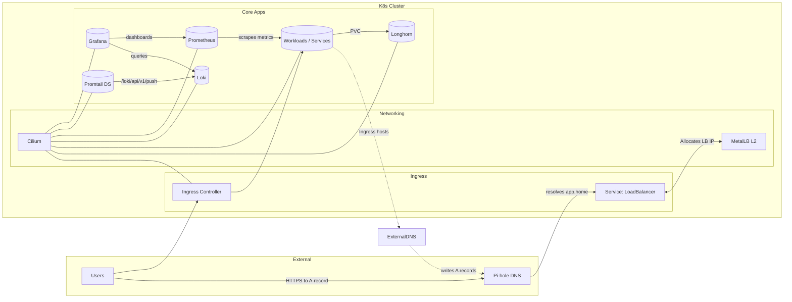

# Homelab Kubernetes Cluster (Talos Linux)

Bare-metal Kubernetes cluster running on Talos Linux. This repository captures the declarative configuration for core platform components (storage, networking, ingress, DNS, and observability) and the workflow I use to deploy and operate them.

Key stack:
- OS/Cluster: Talos Linux (K8s managed by Talos, immutable nodes)
- CNI: Cilium (no kube-proxy)
- Load balancer: MetalLB
- DNS: Pi-hole + ExternalDNS
- Ingress: NGINX Ingress Controller (migration planned; see note below)
- Storage: Longhorn
- Observability: Prometheus, Grafana, Loki, Promtail
- Misc: Metrics Server, Homepage

See docs/ for supporting guides:
- docs/DNS_SERVICES_GUIDE.md
- docs/EXTERNALDNS-SETUP.md
- docs/NETWORKING_GUIDE.md
- docs/TROUBLESHOOTING.md
- docs/logging-architecture.md


## Repository layout

- base/          → Kustomize bases for cluster-scoped and namespace-scoped resources (e.g., MetalLB, Homepage)
- helm/          → Helmfile + per-chart values for core components
- components/    → Reserved for additional apps/addons (not all are committed)
- talos/         → Talos machine configs, kubeconfig, and patches (sensitive; see Safe to commit section)
- docs/          → Architecture notes and runbooks


## Architecture overview

The diagram shows how requests enter the cluster, how L2 IPs and DNS are managed, and how storage and observability pieces fit together.



Notes:
- ExternalDNS updates Pi-hole directly so Ingress hostnames (e.g., grafana.home) resolve on your LAN.
- MetalLB assigns L2 IPs to LoadBalancer services (e.g., the Ingress Controller).
- Cilium provides kube-proxy–less networking (BPF). Ensure kube-proxy is disabled in the cluster config.
- Longhorn backs PersistentVolumeClaims used by applications.
- Promtail ships logs to Loki; Grafana queries Loki and Prometheus for dashboards.


## Important: Ingress controller migration

The current setup uses NGINX Ingress. Plan to migrate since NGINX is expected to be orphaned soon. Recommended path:
1. Install an alternative Ingress controller in parallel with a distinct `ingressClassName`. Viable options: Traefik, HAProxy Ingress, or Envoy Gateway.
2. Update a subset of `Ingress` resources to the new `ingressClassName` and validate routes.
3. Flip remaining `Ingress` resources to the new class.
4. Remove the NGINX release after a soak period.

Because MetalLB is assigning the LB IP and ExternalDNS writes A records for hosts, the cutover can be performed with minimal downtime by using either:
- Two LoadBalancer services and DNS switchover; or
- One LoadBalancer, then change `ingressClassName` on Ingress objects to point to the new controller if it shares the same Service load balancer.

## Deployment workflow

Prerequisites:
- kubectl, helm, helmfile
- talosctl
- Cilium installed in kube-proxy–less mode (done out-of-band; see Cilium docs)
- Optional: SOPS + age, or your alternative secrets manager

High-level steps:

1) Bootstrap cluster (Talos)
- Generate Talos configs and bootstrap the control plane using talosctl or the Talos factory.
- Retrieve kubeconfig (do not commit it).

2) Install/load networking and load balancer
- Ensure Cilium is installed and kube-proxy is disabled.
- Apply MetalLB manifests and your IP pool:
  ```sh
  kubectl apply -k base/metallb
  ```

3) Deploy core stack with Helmfile
- Review `helm/helmfile.yaml` and values in `helm/values/`.
- Create any required Secrets (e.g., `pihole-password`).
- Sync releases:
  ```sh
  helmfile -f helm/helmfile.yaml repos
  helmfile -f helm/helmfile.yaml sync
  ```

4) Homepage (optional)
- Deploy the homepage base:
  ```sh
  kubectl apply -k base/homepage
  ```

5) Validate DNS, ingress, and LB
- Confirm MetalLB assigned an IP to the ingress controller Service.
- Confirm ExternalDNS created A records in Pi-hole (e.g., grafana.home).
- Access apps via your LAN DNS.

6) Observability
- Promtail should be pushing to Loki; Grafana should have Loki and Prometheus as datasources.
- Refer to docs/logging-architecture.md for details and queries.

7) Plan ingress migration
- Install the new ingress controller with a different `ingressClassName`.
- Migrate canaries; then flip production `Ingress` resources.

Day-2 operations:
- Helmfile for chart updates and drift reconciliation.
- New workloads by:
  - Creating a new Helm release in `helm/helmfile.yaml` with a `helm/values/<app>.values.yaml`
  - Or, adding Kustomize bases in `base/<app>`
