# DNS Services Deep Dive: Pihole vs ExternalDNS

## Table of Contents
1. [DNS Fundamentals](#dns-fundamentals)
2. [Pihole Overview](#pihole-overview)
3. [ExternalDNS Overview](#externaldns-overview)
4. [Key Differences](#key-differences)
5. [Use Cases and Architecture](#use-cases-and-architecture)
6. [Integration Patterns](#integration-patterns)
7. [Homelab Implementation](#homelab-implementation)
8. [Comparison Matrix](#comparison-matrix)

---

## DNS Fundamentals

### What DNS Actually Does

DNS (Domain Name System) serves multiple purposes beyond simple name resolution:

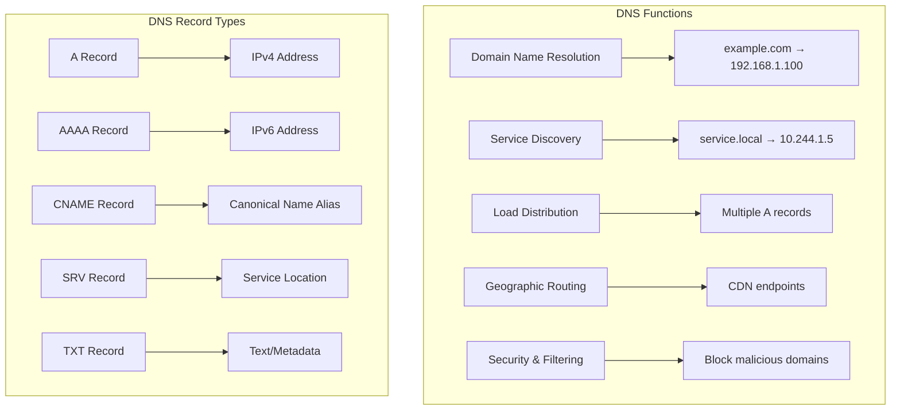

### DNS in Kubernetes Context

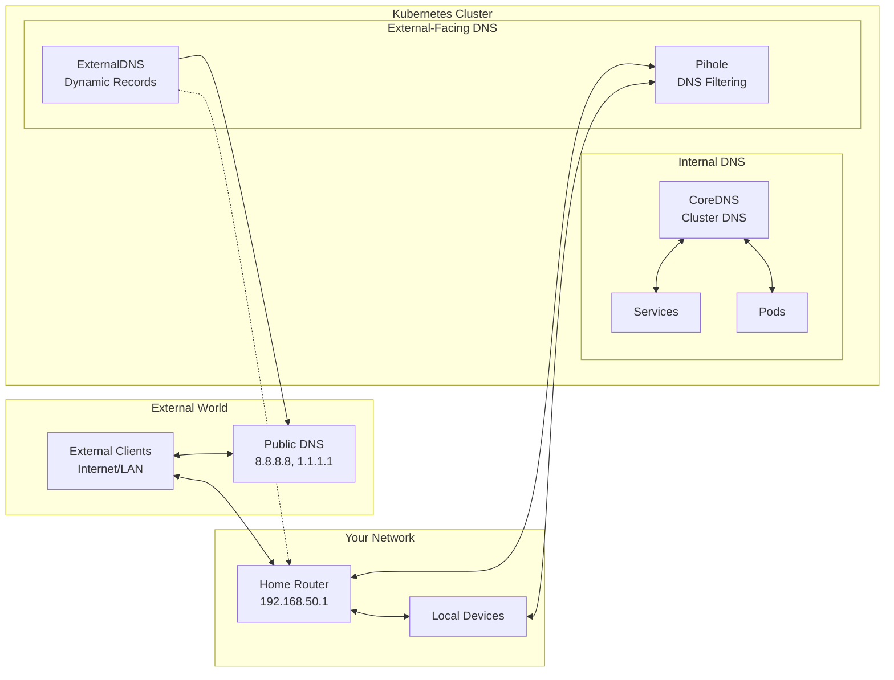

---

## Pihole Overview

### What Pihole Is

Pihole is a **DNS sinkhole** that acts as a network-wide ad and tracking blocker:

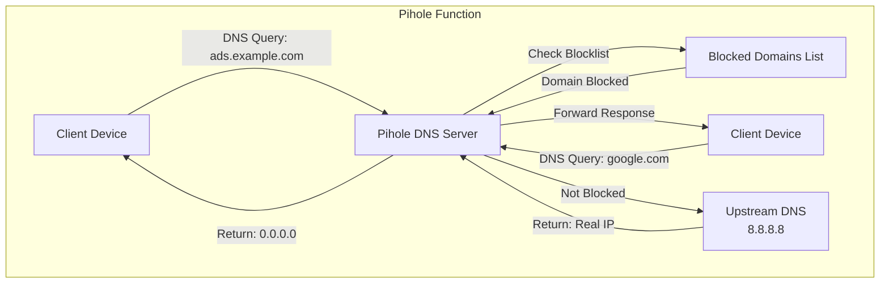

### Pihole Architecture in Your Homelab

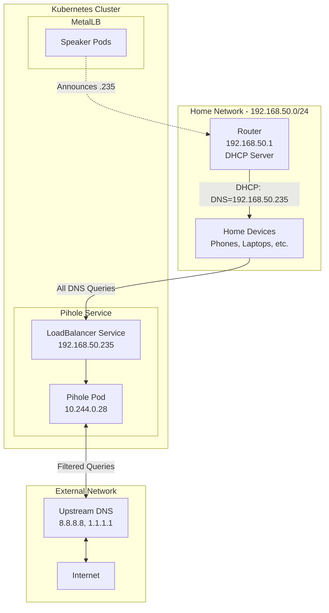

### Pihole Core Features

1. **Ad Blocking**: Blocks advertising domains at DNS level
2. **Tracking Protection**: Blocks analytics and tracking domains
3. **Custom Filtering**: Add your own blocklists and whitelists
4. **Network-Wide**: Works for all devices on your network
5. **Web Interface**: Monitor queries and manage settings
6. **Local DNS**: Can serve local domain names

#### Example Pihole Configuration
```bash
# Pihole blocks these automatically:
ads.example.com         → 0.0.0.0 (blocked)
tracker.analytics.com   → 0.0.0.0 (blocked)
malware.badsite.com     → 0.0.0.0 (blocked)

# But allows legitimate traffic:
google.com             → 142.250.80.78 (allowed)
github.com             → 140.82.113.4 (allowed)

# Can also serve local domains:
homelab.local          → 192.168.50.235 (custom)
nas.local              → 192.168.50.100 (custom)
```

---

## ExternalDNS Overview

### What ExternalDNS Is

ExternalDNS is a **Kubernetes controller** that automatically creates DNS records in external DNS providers:

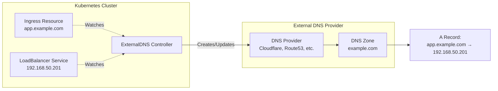

### ExternalDNS Architecture

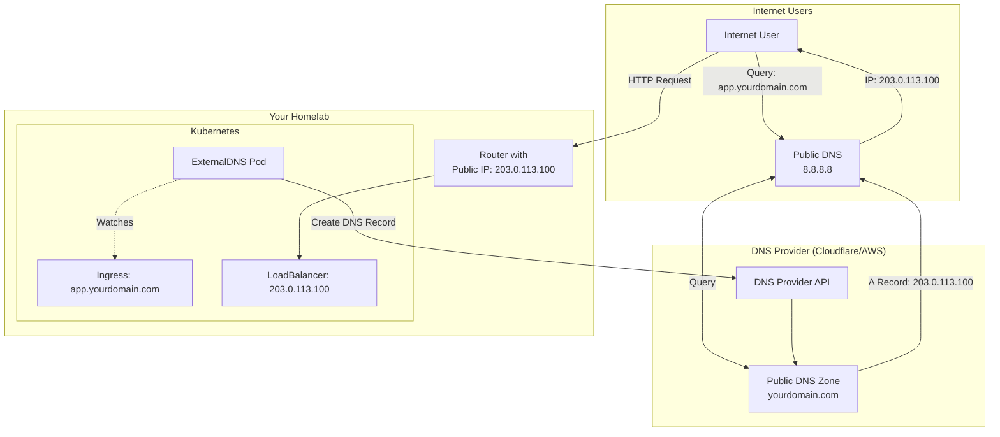

### ExternalDNS Core Features

1. **Automatic DNS Management**: Creates/updates/deletes DNS records automatically
2. **Kubernetes Integration**: Watches Ingress and Service resources
3. **Multiple Providers**: Supports Cloudflare, AWS Route53, Google DNS, etc.
4. **Public Internet**: Makes your services accessible from the internet
5. **Dynamic Updates**: DNS records update when services change
6. **SSL Integration**: Works with cert-manager for automatic SSL

#### Example ExternalDNS Workflow
```yaml
# You create an Ingress:
apiVersion: networking.k8s.io/v1
kind: Ingress
metadata:
  name: my-app
  annotations:
    external-dns.alpha.kubernetes.io/hostname: app.yourdomain.com
spec:
  rules:
  - host: app.yourdomain.com
    http:
      paths:
      - path: /
        pathType: Prefix
        backend:
          service:
            name: my-app-service
            port:
              number: 80

# ExternalDNS automatically creates:
# A Record: app.yourdomain.com → 203.0.113.100 (your public IP)
```

---

## Key Differences

### Fundamental Purpose

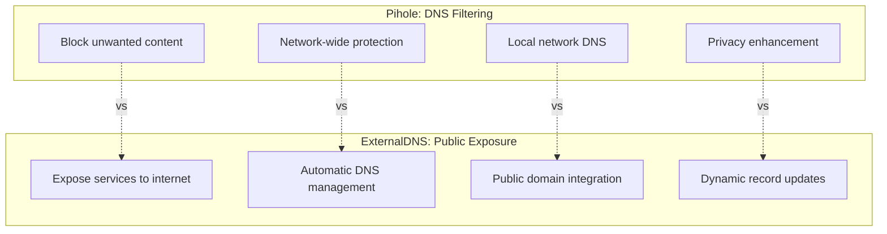

### Traffic Direction

| Aspect | Pihole | ExternalDNS |
|--------|--------|-------------|
| **Traffic Direction** | Inbound to your network | Outbound to internet |
| **DNS Query Source** | Local devices | Internet users |
| **Primary Function** | Filter/Block domains | Create/Manage records |
| **Target Audience** | Your family/devices | Public users |
| **Network Scope** | LAN (192.168.x.x) | WAN (Public Internet) |

### Technical Differences

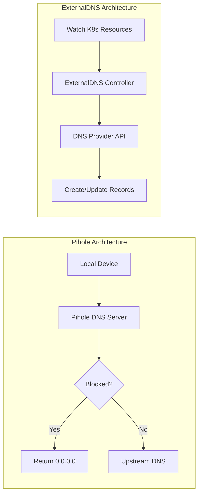

---

## Use Cases and Architecture

### When to Use Pihole

#### Perfect For:
- **Ad blocking** across all home devices
- **Privacy protection** from tracking domains
- **Parental controls** (block inappropriate content)
- **Local DNS resolution** (homelab.local → 192.168.50.100)
- **Network monitoring** (see what devices are doing)
- **Bandwidth optimization** (less ad traffic)

#### Real-World Pihole Scenarios:
```bash
# Family browsing protection:
smartphone.local → Pihole → Blocks ads/trackers → Clean browsing

# IoT device security:
smarttv.local → Pihole → Blocks telemetry domains → Privacy protection

# Local service access:
laptop.local → Pihole → homelab.local → 192.168.50.235 → Direct access
```

### When to Use ExternalDNS

#### Perfect For:
- **Exposing homelab services** to the internet
- **Dynamic DNS management** for changing IPs
- **Professional websites** hosted at home
- **Remote access** to services
- **SSL certificate automation** with public domains
- **API endpoints** for mobile apps

#### Real-World ExternalDNS Scenarios:
```bash
# Remote homelab access:
Internet user → api.yourdomain.com → ExternalDNS → Your public IP → Homelab

# Dynamic IP handling:
ISP changes IP → ExternalDNS detects → Updates DNS → api.yourdomain.com still works

# SSL certificate automation:
cert-manager + ExternalDNS → Automatic Let's Encrypt → HTTPS everywhere
```

### Can You Use Both?

**Absolutely! They complement each other perfectly:**

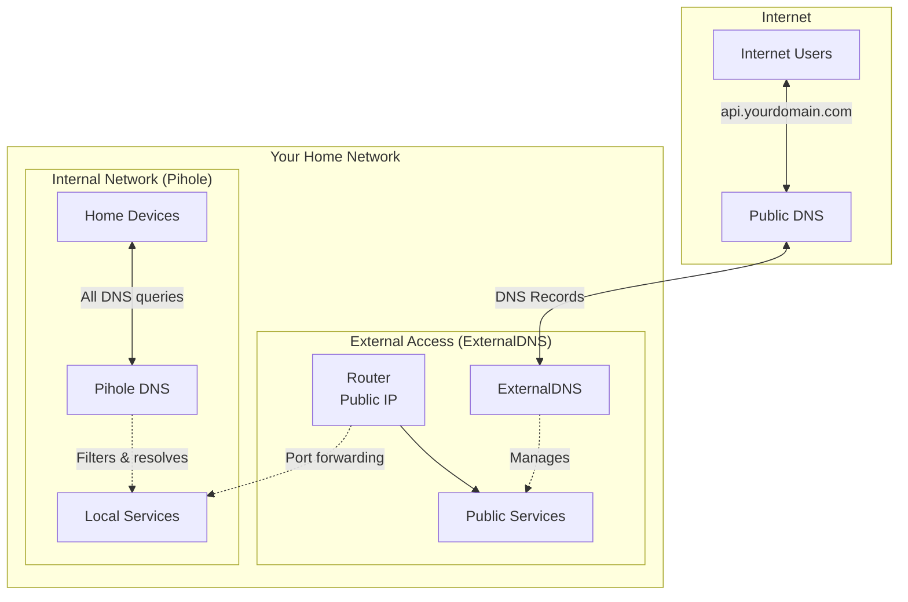

---

## Integration Patterns

### Pattern 1: Pihole + ExternalDNS Together

```yaml
# ExternalDNS exposes your services publicly
apiVersion: networking.k8s.io/v1
kind: Ingress
metadata:
  name: homelab-api
  annotations:
    external-dns.alpha.kubernetes.io/hostname: api.mydomain.com
    nginx.ingress.kubernetes.io/ssl-redirect: "true"
spec:
  tls:
  - hosts:
    - api.mydomain.com
    secretName: api-tls
  rules:
  - host: api.mydomain.com
    http:
      paths:
      - path: /
        pathType: Prefix
        backend:
          service:
            name: api-service
            port:
              number: 80

---
# Pihole provides local DNS and filtering
apiVersion: v1
kind: Service
metadata:
  name: pihole-web
  annotations:
    metallb.universe.tf/allow-shared-ip: "pihole-svc"
spec:
  type: LoadBalancer
  loadBalancerIP: 192.168.50.235
  ports:
  - port: 80
    name: http
  - port: 443
    name: https
  selector:
    app: pihole
```

### Pattern 2: Split-Brain DNS

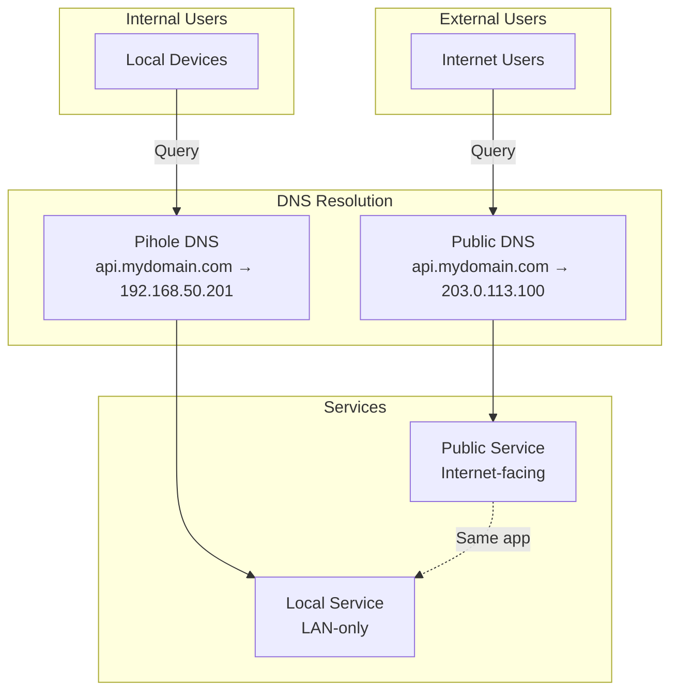

This allows:
- **External users** access via public IP (slower, more secure)
- **Internal users** access via local IP (faster, direct)
- **Same services** accessible both ways

---

## Homelab Implementation

### Recommended Architecture

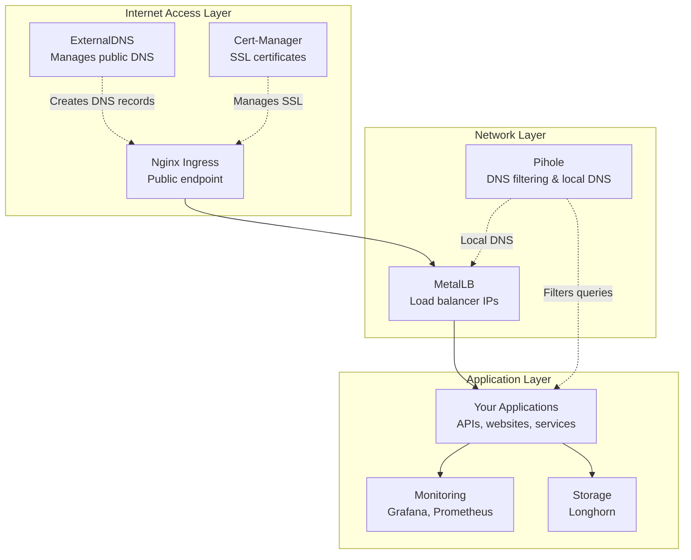

### Step-by-Step Implementation

#### 1. Start with Pihole (Internal DNS)
```bash
# Already implemented in your setup!
kubectl get svc -n pihole-system
# pihole-web: 192.168.50.235:80/443
# pihole-dns-*: 192.168.50.235:53
```

#### 2. Add ExternalDNS (External DNS)
```yaml
apiVersion: apps/v1
kind: Deployment
metadata:
  name: external-dns
  namespace: external-dns-system
spec:
  selector:
    matchLabels:
      app: external-dns
  template:
    spec:
      containers:
      - name: external-dns
        image: k8s.gcr.io/external-dns/external-dns:v0.14.0
        args:
        - --source=ingress
        - --source=service
        - --provider=cloudflare  # or your DNS provider
        - --registry=txt
        - --txt-owner-id=homelab
        env:
        - name: CF_API_TOKEN
          valueFrom:
            secretKeyRef:
              name: cloudflare-api-token
              key: api-token
```

#### 3. Configure Local DNS in Pihole
```bash
# Add local domain entries in Pihole web interface
# 192.168.50.201 → homelab.local (nginx ingress)
# 192.168.50.235 → pihole.local (pihole web)
# 192.168.50.100 → nas.local (if you have a NAS)
```

#### 4. Set Up Public Services
```yaml
apiVersion: networking.k8s.io/v1
kind: Ingress
metadata:
  name: homelab-public
  annotations:
    external-dns.alpha.kubernetes.io/hostname: homelab.yourdomain.com
    cert-manager.io/cluster-issuer: letsencrypt-prod
spec:
  tls:
  - hosts:
    - homelab.yourdomain.com
    secretName: homelab-tls
  rules:
  - host: homelab.yourdomain.com
    http:
      paths:
      - path: /
        pathType: Prefix
        backend:
          service:
            name: homelab-service
            port:
              number: 80
```

---

## Comparison Matrix

| Feature | Pihole | ExternalDNS | Both Together |
|---------|--------|-------------|---------------|
| **Ad Blocking** | ✅ Primary function | ❌ Not applicable | ✅ Local protection |
| **Public DNS** | ❌ Local only | ✅ Primary function | ✅ External access |
| **Local DNS** | ✅ Custom domains | ❌ External only | ✅ Split-brain DNS |
| **SSL/HTTPS** | ⚠️ Manual setup | ✅ With cert-manager | ✅ Auto SSL |
| **Privacy** | ✅ Network-wide | ⚠️ Public exposure | ⚡ Best of both |
| **Remote Access** | ❌ Local only | ✅ Internet access | ✅ Flexible access |
| **Complexity** | 🟢 Simple | 🟡 Moderate | 🔴 Advanced |
| **Cost** | 🟢 Free | 🟡 DNS provider costs | 🟡 DNS costs only |
| **Maintenance** | 🟢 Low | 🟡 Moderate | 🟡 Moderate |

### Decision Matrix

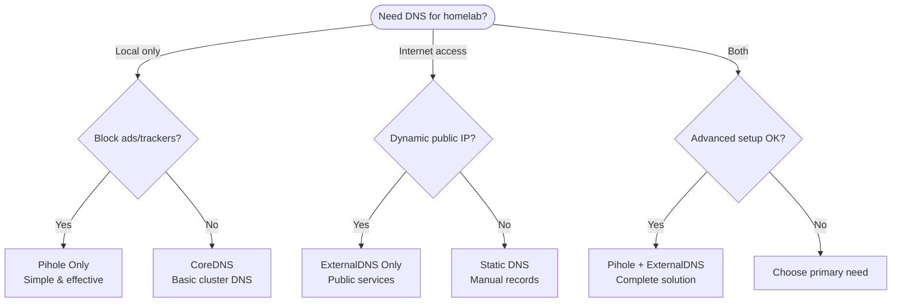

---

## Key Takeaways

### Pihole is for **PROTECTION & PRIVACY**
- 🛡️ **Blocks ads and trackers** network-wide
- 🏠 **Local DNS server** for your home network
- 📊 **Monitoring** what devices are doing
- 🚫 **Parental controls** and content filtering

### ExternalDNS is for **PUBLIC EXPOSURE**
- 🌐 **Makes services accessible** from the internet
- 🤖 **Automates DNS management** for public domains
- 🔄 **Dynamic updates** when services change
- 🔒 **Enables SSL automation** with public certificates

### Together They Provide:
- **Internal protection** (Pihole filtering)
- **External accessibility** (ExternalDNS records)
- **Flexible access patterns** (local vs remote)
- **Professional setup** (like enterprise networks)

### For Your Homelab:
- **Start with Pihole** (already done!) for internal DNS and ad blocking
- **Add ExternalDNS** if you want to expose services to the internet
- **Use both** for a complete, professional networking setup

The beauty is that they work at different layers and serve different purposes - Pihole protects your internal network while ExternalDNS exposes selected services to the world! 🌟