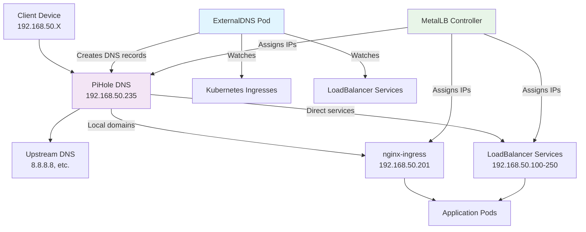
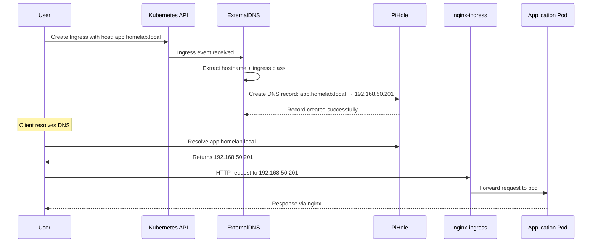
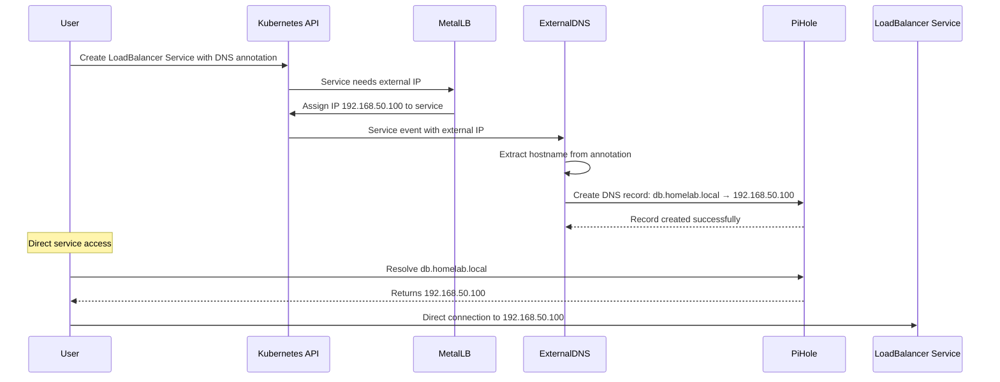

# ExternalDNS + PiHole + MetalLB Setup Guide

This document explains how ExternalDNS integrates with PiHole and MetalLB in your Kubernetes homelab to provide automatic DNS management.

## Overview

ExternalDNS automatically creates DNS records in PiHole based on Kubernetes Ingress and Service resources, eliminating the need to manually manage DNS entries for your homelab services.

## Architecture Diagram



## Component Integration

### 1. ExternalDNS + Ingress Flow



### 2. ExternalDNS + MetalLB Service Flow



## Configuration Details

### ExternalDNS Configuration

```yaml
# values/externaldns.values.yaml
provider: pihole
policy: upsert-only
txtOwnerId: "homelab"
global:
  security:
    allowInsecureImages: true
image:
  registry: registry.k8s.io
  repository: external-dns/external-dns
  tag: "v0.20.0"
pihole:
  server: http://pihole-web.pihole-system.svc.cluster.local
extraEnvVars:
  - name: EXTERNAL_DNS_PIHOLE_PASSWORD
    valueFrom:
      secretKeyRef:
        name: pihole-password
        key: password
  - name: EXTERNAL_DNS_PIHOLE_API_VERSION
    value: "6"
serviceAccount:
  create: true
  name: "external-dns"
ingressClassFilters:
  - nginx-internal
```

### Key Configuration Parameters

- **`provider: pihole`** - Use PiHole as DNS provider
- **`ingressClassFilters: [nginx-internal]`** - Only process ingresses with this class
- **`sources: [service, ingress]`** - Watch both services and ingresses
- **`policy: upsert-only`** - Create and update records, never delete
- **`EXTERNAL_DNS_PIHOLE_API_VERSION: "6"`** - Use PiHole API v6

### Current Component IPs

| Component | Type | IP Address | Purpose |
|-----------|------|------------|---------|
| PiHole Web UI | LoadBalancer | 192.168.50.235 | DNS server & web interface |
| nginx-ingress | LoadBalancer | 192.168.50.201 | Ingress controller for web apps |
| MetalLB Pool | Configuration | 192.168.50.100-250 | Available IP range for services |

## Usage Examples

### 1. Web Application via Ingress

Create an ingress resource and ExternalDNS will automatically create the DNS record:

```yaml
apiVersion: apps/v1
kind: Deployment
metadata:
  name: test-app
  namespace: default
spec:
  replicas: 1
  selector:
    matchLabels:
      app: test-app
  template:
    metadata:
      labels:
        app: test-app
    spec:
      containers:
      - name: nginx
        image: nginx:alpine
        ports:
        - containerPort: 80
        securityContext:
          allowPrivilegeEscalation: false
          capabilities:
            drop: ["ALL"]
          runAsNonRoot: true
          runAsUser: 1000
          seccompProfile:
            type: RuntimeDefault
---
apiVersion: v1
kind: Service
metadata:
  name: test-app-service
  namespace: default
spec:
  selector:
    app: test-app
  ports:
  - port: 80
    targetPort: 80
---
apiVersion: networking.k8s.io/v1
kind: Ingress
metadata:
  name: test-app-ingress
  namespace: default
  annotations:
    # ExternalDNS will process this ingress
    nginx.ingress.kubernetes.io/rewrite-target: /
spec:
  ingressClassName: nginx-internal  # Must match ingressClassFilters
  rules:
  - host: test.homelab.local  # ExternalDNS creates: test.homelab.local → 192.168.50.201
    http:
      paths:
      - path: /
        pathType: Prefix
        backend:
          service:
            name: test-app-service
            port:
              number: 80
```

**Result:**
- ExternalDNS creates DNS record: `test.homelab.local → 192.168.50.201`
- Clients can access: `http://test.homelab.local`
- Traffic flows: Client → PiHole DNS → nginx-ingress → test-app pod

### 2. Direct Service via LoadBalancer

For services that need direct access (databases, APIs, etc.):

```yaml
apiVersion: v1
kind: Service
metadata:
  name: database-service
  namespace: default
  annotations:
    # Tell ExternalDNS to create DNS record
    external-dns.alpha.kubernetes.io/hostname: db.homelab.local
spec:
  type: LoadBalancer
  # Optional: request specific IP from MetalLB pool
  loadBalancerIP: 192.168.50.100
  ports:
  - port: 5432
    targetPort: 5432
  selector:
    app: postgresql
```

**Result:**
- MetalLB assigns IP: `192.168.50.100`
- ExternalDNS creates DNS record: `db.homelab.local → 192.168.50.100`
- Direct database access: `psql -h db.homelab.local -p 5432`

## Troubleshooting

### Check ExternalDNS Status
```bash
# Check pods
kubectl -n pihole-system get pods -l "app.kubernetes.io/name=external-dns"

# Check logs
kubectl -n pihole-system logs -l "app.kubernetes.io/name=external-dns" --tail=20
```

### Verify DNS Records
```bash
# Test DNS resolution
nslookup test.homelab.local 192.168.50.235

# Check PiHole directly
curl -s "http://192.168.50.235/admin/api.php?topItems" | jq
```

### Common Issues

1. **Pod stuck in ImagePullBackOff**
   - Solution: Use `registry.k8s.io/external-dns/external-dns:v0.20.0`

2. **404 API errors**
   - Solution: Set `EXTERNAL_DNS_PIHOLE_API_VERSION=6` for PiHole v6.x

3. **DNS records not created**
   - Check ingress class matches `ingressClassFilters`
   - Verify PiHole password secret exists
   - Check ExternalDNS has proper RBAC permissions

## Benefits

✅ **Automatic DNS management** - No manual DNS record creation  
✅ **Homelab-friendly** - Works with local IP ranges  
✅ **Service discovery** - Easy access to services via domain names  
✅ **Load balancer integration** - Works with MetalLB IP assignment  
✅ **Multiple sources** - Supports both Ingress and Service resources  
✅ **Safe operations** - `upsert-only` policy prevents accidental deletions  

## Testing Your Setup

Deploy the test ingress above and verify:

1. **ExternalDNS processes it:**
   ```bash
   kubectl -n pihole-system logs -l "app.kubernetes.io/name=external-dns" --tail=10
   ```

2. **DNS record is created:**
   ```bash
   nslookup test.homelab.local 192.168.50.235
   ```

3. **Service is accessible:**
   ```bash
   curl -H "Host: test.homelab.local" http://192.168.50.201
   ```

4. **Clean up test:**
   ```bash
   kubectl delete ingress test-app-ingress
   kubectl delete service test-app-service  
   kubectl delete deployment test-app
   ```
