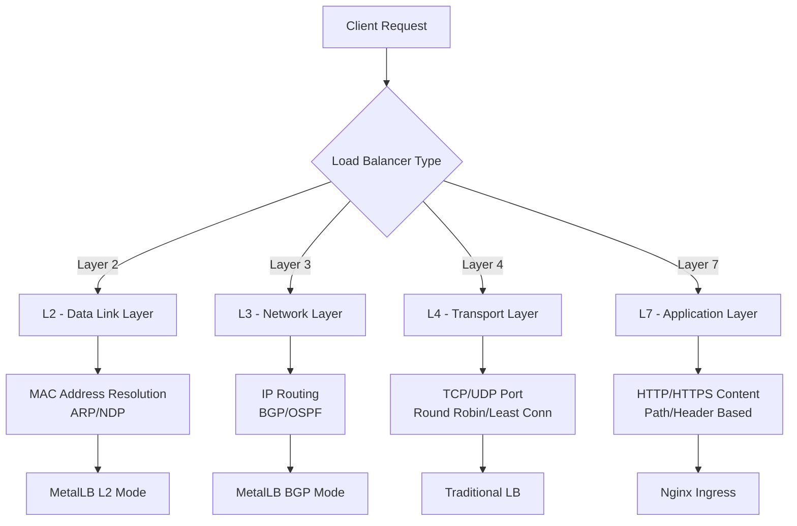
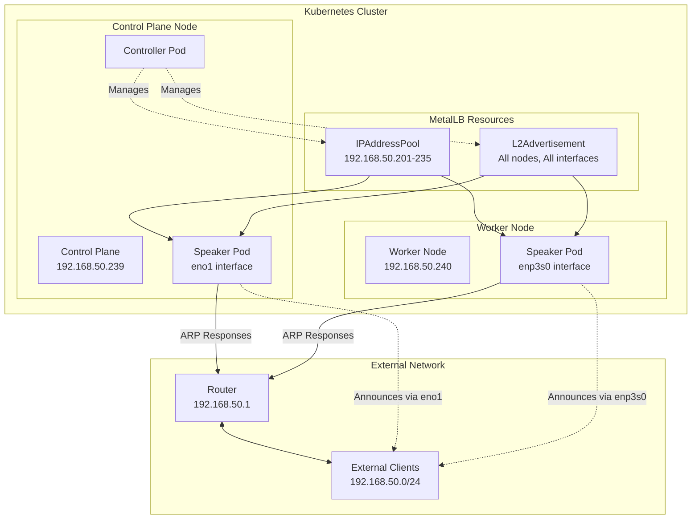
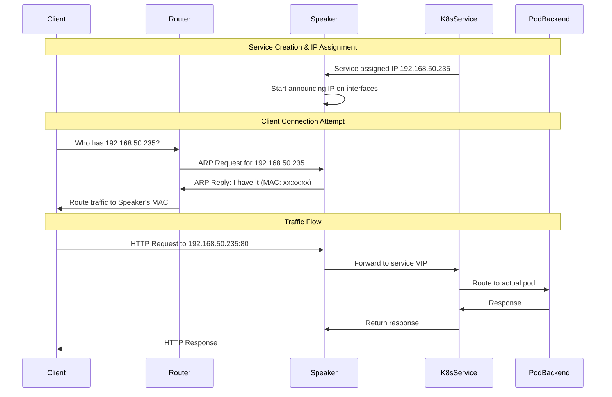
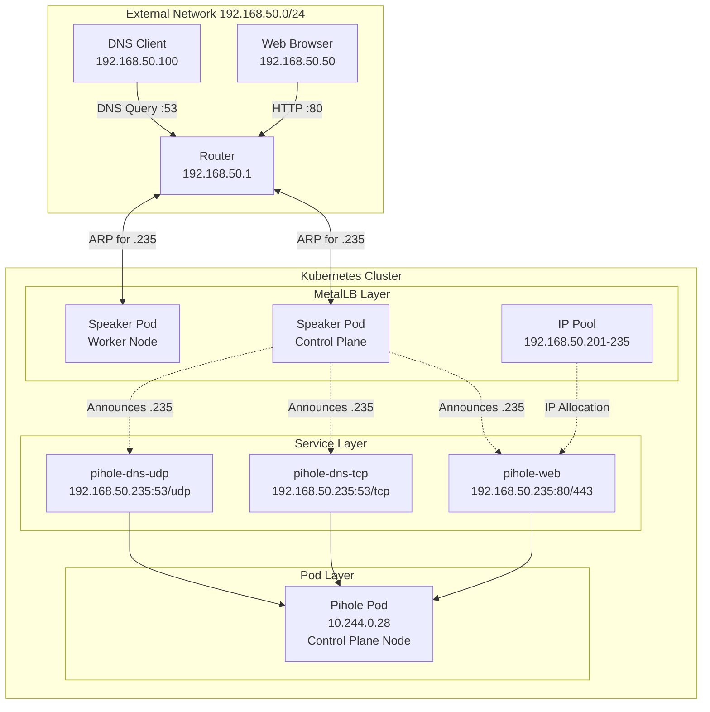
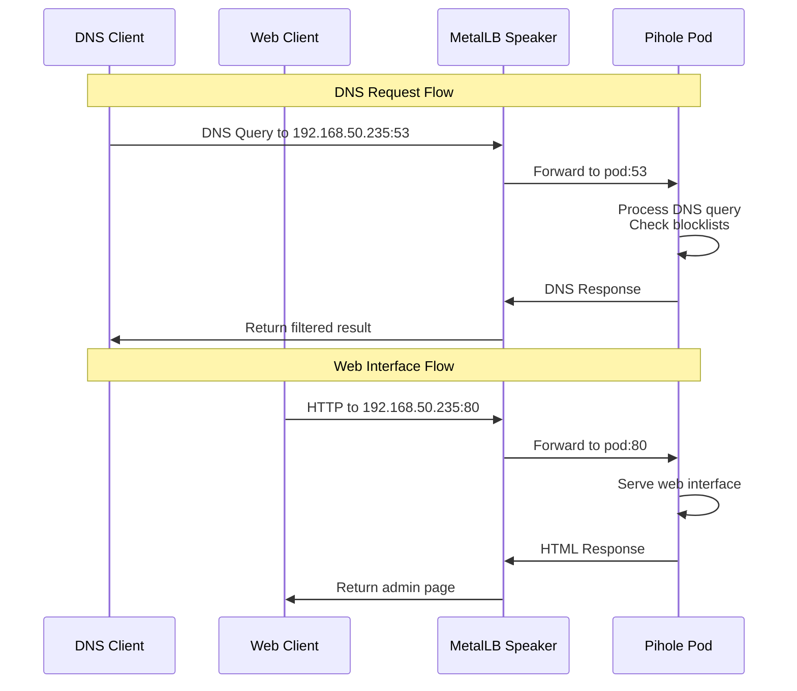
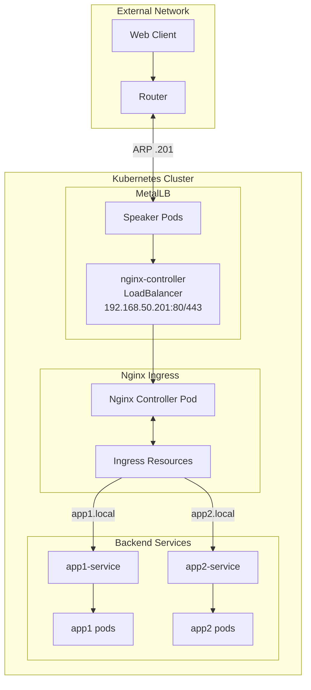
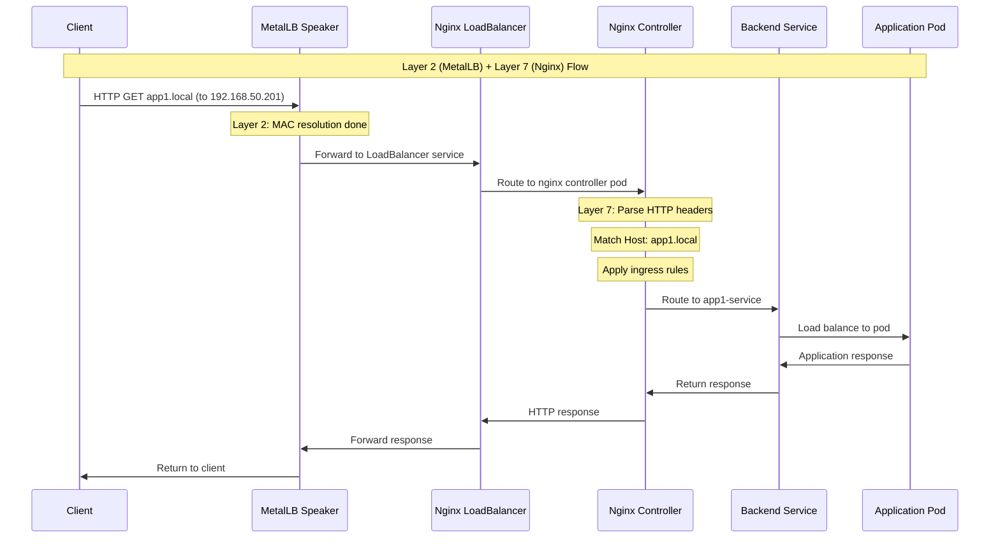
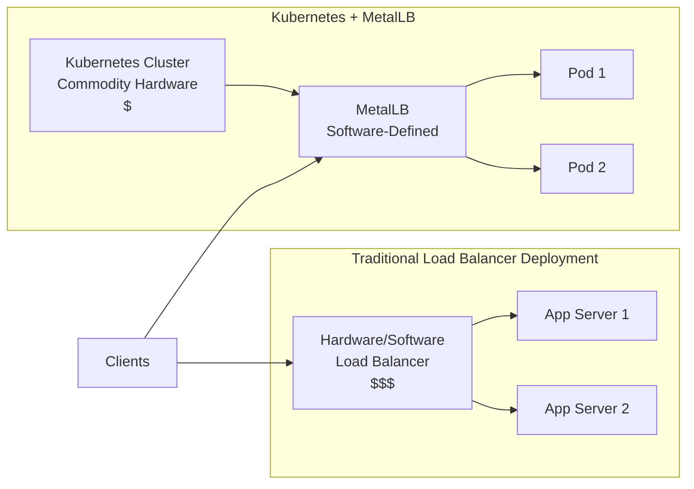

# Homelab Networking Deep Dive: Load Balancing, MetalLB, and Service Integration

## Table of Contents
1. [Load Balancer Fundamentals](#load-balancer-fundamentals)
2. [MetalLB Architecture](#metallb-architecture)
3. [Pihole + MetalLB Integration](#pihole--metallb-integration)
4. [Nginx Ingress + MetalLB](#nginx-ingress--metallb)
5. [Layer 2 vs Layer 4 Load Balancing](#layer-2-vs-layer-4-load-balancing)
6. [Traffic Flow Analysis](#traffic-flow-analysis)
7. [Troubleshooting Network Issues](#troubleshooting-network-issues)

---

## Load Balancer Fundamentals

### What Most People Think Load Balancers Do vs What They Actually Do

#### Common Misconception:
> "Load balancers just distribute traffic between multiple backend servers"

#### Reality:
Load balancers operate at multiple network layers and perform several critical functions:

1. **IP Address Management** - Assign and announce external IPs
2. **Traffic Distribution** - Balance load across backends (traditional view)
3. **Service Discovery** - Map services to network endpoints
4. **Health Checking** - Monitor backend availability
5. **Network Advertisement** - Announce IPs via routing protocols

### Load Balancer Types by OSI Layer



#### Layer 2 (Data Link) - What MetalLB Does
- **Function**: MAC address resolution and local network announcement
- **Mechanism**: ARP (IPv4) and NDP (IPv6) responses
- **Scope**: Same broadcast domain/VLAN
- **Example**: MetalLB speakers announce "I have IP 192.168.50.235 at MAC aa:bb:cc:dd:ee:ff"

#### Layer 4 (Transport) - Traditional Load Balancing
- **Function**: TCP/UDP port-based traffic distribution
- **Mechanism**: Connection tracking and backend selection
- **Scope**: Transport layer protocols
- **Example**: Distribute TCP connections to multiple backend pods

---

## MetalLB Architecture

### Core Components



### How MetalLB Assigns and Announces IPs

1. **IP Pool Management**
   ```yaml
   apiVersion: metallb.io/v1beta1
   kind: IPAddressPool
   metadata:
     name: pool
   spec:
     addresses:
     - 192.168.50.201-192.168.50.235  # Available IP range
   ```

2. **Service IP Assignment**
   - Kubernetes creates LoadBalancer service
   - MetalLB controller assigns IP from pool
   - IP is marked as allocated in pool status

3. **L2 Advertisement Process**
   ```yaml
   apiVersion: metallb.io/v1beta1
   kind: L2Advertisement
   metadata:
     name: pool
   spec:
     ipAddressPools: ["pool"]
     # No nodeSelectors = All nodes can announce
     # No interfaces = Use all available interfaces
   ```

### Speaker Pod Responsibilities



---

## Pihole + MetalLB Integration

### Service Architecture



### Shared IP Configuration

All Pihole services share the same external IP using the annotation:
```yaml
metadata:
  annotations:
    metallb.universe.tf/allow-shared-ip: "pihole-svc"
```

**Why This Works:**
- Different ports (53/tcp, 53/udp, 80/tcp, 443/tcp)
- Same destination pod can handle all protocols
- MetalLB speaker announces the same IP for all services
- Kubernetes service mesh routes based on port

### Traffic Flow Details



---

## Nginx Ingress + MetalLB

### Architecture Overview



### Layer 7 Load Balancing vs Layer 2

**MetalLB (Layer 2):**
- Assigns and announces IP address
- Handles MAC address resolution
- Gets traffic to the cluster

**Nginx Ingress (Layer 7):**
- HTTP/HTTPS content inspection
- Host-based routing
- Path-based routing
- SSL termination

### Request Flow Through Both Layers



---

## Layer 2 vs Layer 4 Load Balancing

### Detailed Comparison

| Aspect | Layer 2 (Data Link) | Layer 4 (Transport) |
|--------|---------------------|---------------------|
| **Function** | MAC address resolution | Connection distribution |
| **Operates On** | Ethernet frames | TCP/UDP packets |
| **Awareness** | MAC addresses, VLANs | IP addresses, ports |
| **Distribution Method** | ARP/NDP announcement | Connection tracking |
| **Scope** | Broadcast domain | Routed networks |
| **Examples** | MetalLB L2 mode | HAProxy, F5, AWS NLB |
| **Health Checks** | Basic connectivity | Application-level |
| **Session Persistence** | Based on client MAC | Based on IP/port tuple |

### Why MetalLB Uses Layer 2



**MetalLB L2 Advantages:**
- ✅ **No special hardware** required
- ✅ **Works with existing switches**
- ✅ **Simple configuration**
- ✅ **Fast failover** (gratuitous ARP)
- ✅ **Cost-effective** for small deployments

**MetalLB L2 Limitations:**
- ❌ **Single point of failure** (active/passive)
- ❌ **Limited to broadcast domain**
- ❌ **No true load distribution** at L2 level

### When to Use Each Type

#### Use Layer 2 (MetalLB L2) When:
- Homelab or small office setup
- Single network segment
- Cost is a primary concern
- Simple networking requirements

#### Use Layer 4 When:
- Multiple data centers
- High availability requirements
- Complex traffic routing needs
- Large scale deployments

---

## Traffic Flow Analysis

### Complete Request Journey

```mermaid
flowchart TD
    START([Client: curl http://192.168.50.235/admin]) 
    
    subgraph "Step 1: Layer 2 Resolution"
        ARP[Client sends ARP:<br/>"Who has 192.168.50.235?"]
        SPEAKER_RESP[Speaker responds:<br/>"I have it, MAC: xx:xx"]
    end
    
    subgraph "Step 2: IP Routing"
        ROUTE[Router forwards to<br/>Speaker's MAC address]
        RECEIVE[Speaker receives<br/>Ethernet frame]
    end
    
    subgraph "Step 3: Service Mesh"
        KUBE_SVC[Kubernetes service<br/>pihole-web matches]
        ENDPOINT[Service endpoint<br/>points to pod IP]
    end
    
    subgraph "Step 4: Pod Processing"
        POD_RECEIVE[Pihole pod receives<br/>HTTP request]
        POD_PROCESS[Pod processes request<br/>Serves admin interface]
    end
    
    subgraph "Step 5: Response Journey"
        POD_RESPOND[Pod sends HTTP response]
        SVC_RETURN[Service routes back<br/>through speaker]
        CLIENT_RECEIVE[Client receives<br/>HTML page]
    end
    
    START --> ARP
    ARP --> SPEAKER_RESP
    SPEAKER_RESP --> ROUTE
    ROUTE --> RECEIVE
    RECEIVE --> KUBE_SVC
    KUBE_SVC --> ENDPOINT
    ENDPOINT --> POD_RECEIVE
    POD_RECEIVE --> POD_PROCESS
    POD_PROCESS --> POD_RESPOND
    POD_RESPOND --> SVC_RETURN
    SVC_RETURN --> CLIENT_RECEIVE
    CLIENT_RECEIVE --> END([Success: Pihole admin page])
```

### Network Packet Analysis

#### ARP Resolution Phase
```bash
# What happens when client requests 192.168.50.235
$ tcpdump -i eth0 arp
08:00:00.000000 ARP, Request who-has 192.168.50.235 tell 192.168.50.50
08:00:00.000100 ARP, Reply 192.168.50.235 is-at aa:bb:cc:dd:ee:ff
```

#### HTTP Request Phase
```bash
# HTTP traffic to the announced IP
$ tcpdump -i eth0 host 192.168.50.235
08:00:01.000000 IP 192.168.50.50.12345 > 192.168.50.235.80: Flags [S], seq 1234
08:00:01.000100 IP 192.168.50.235.80 > 192.168.50.50.12345: Flags [S.], seq 5678
```

---

## Troubleshooting Network Issues

### Common Problems and Solutions

#### Problem: Service Gets IP But Not Reachable

```bash
# 1. Check speaker announcements
kubectl logs -n metallb-system -l component=speaker | grep "192.168.50.235"

# 2. Verify ARP table on client
ping 192.168.50.235  # Should populate ARP table
arp -a | grep 192.168.50.235

# 3. Check interface configuration
kubectl get l2advertisement -n metallb-system -o yaml
```

#### Problem: Multiple Services Share IP But Only One Works

```bash
# Check service configuration
kubectl get svc -n pihole-system -o wide
kubectl describe svc pihole-web pihole-dns-tcp -n pihole-system

# Verify shared IP annotation
kubectl get svc -n pihole-system -o yaml | grep "allow-shared-ip"

# Test different ports
nc -zv 192.168.50.235 80   # Web
nc -zv 192.168.50.235 53   # DNS
```

#### Problem: Speaker Not Announcing on Correct Interface

```bash
# Check node interfaces
kubectl get nodes -o wide

# Check speaker logs for interface detection
kubectl logs -n metallb-system speaker-<id> | grep "createARPResponder"

# Manual interface specification (if needed)
apiVersion: metallb.io/v1beta1
kind: L2Advertisement
metadata:
  name: pool
spec:
  ipAddressPools: ["pool"]
  interfaces: ["eno1", "enp3s0"]  # Specify interfaces
```

### Network Validation Commands

```bash
# Complete network health check
echo "=== MetalLB Status ==="
kubectl get pods -n metallb-system
kubectl get ipaddresspool,l2advertisement -n metallb-system

echo "=== LoadBalancer Services ==="
kubectl get svc -A --field-selector='spec.type=LoadBalancer'

echo "=== Network Connectivity Tests ==="
for ip in 192.168.50.201 192.168.50.235 192.168.50.234; do
  echo -n "Testing $ip: "
  ping -c 1 -W 2 $ip >/dev/null 2>&1 && echo "OK" || echo "FAIL"
done

echo "=== ARP Table ==="
arp -a | grep "192.168.50.2"

echo "=== Speaker Announcements ==="
kubectl logs -n metallb-system -l component=speaker --tail=20 | grep -E "(announce|error)"
```

---

## Key Takeaways

### Understanding Load Balancer Layers

1. **Layer 2 (MetalLB)**: Gets traffic TO your cluster
   - Handles IP assignment and advertisement
   - Manages MAC address resolution
   - Provides basic high availability

2. **Layer 4 (Service Mesh)**: Routes traffic WITHIN your cluster
   - TCP/UDP port-based routing
   - Connection load balancing
   - Health checking

3. **Layer 7 (Ingress)**: Smart application routing
   - HTTP header inspection
   - Content-based decisions
   - SSL termination

### MetalLB's Role in Your Homelab

MetalLB acts as the **"front door"** to your Kubernetes cluster:
- Assigns real IPs from your home network
- Makes services accessible from your LAN
- Eliminates the need for NodePort or port forwarding
- Provides a cloud-like LoadBalancer experience

### Best Practices

1. **IP Pool Planning**: Reserve a range for MetalLB exclusive use
2. **Shared IPs**: Use `allow-shared-ip` annotation for multi-port services
3. **Traffic Policy**: Use `Cluster` for multi-node load balancing
4. **Interface Selection**: Let MetalLB auto-detect unless you have specific requirements
5. **Monitoring**: Regularly check speaker logs and ARP tables

---

**Remember**: MetalLB doesn't just "balance load" in the traditional sense - it makes Kubernetes services accessible by managing IP addresses and network advertisements at Layer 2. The actual load balancing happens at higher layers through Kubernetes services and ingress controllers.
