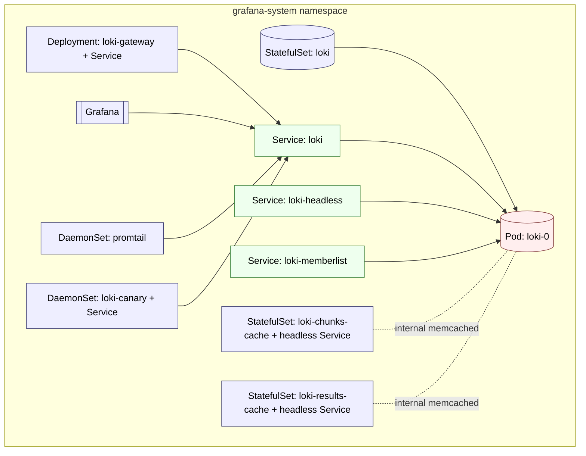

# Logging Architecture: Grafana, Loki, and Promtail

This document explains how Grafana, Loki, and Promtail work together to deliver cluster-wide logging and observability. It includes Mermaid diagrams for data flow and component relationships, and clarifies why you see multiple Loki pods and services even when running the single-binary mode.

## High-level Overview

- Promtail runs on each node (DaemonSet), discovers container logs, enriches them with labels (namespace, pod, container, node), and pushes them to Loki.
- Loki stores and indexes logs. In single-binary mode, Loki runs as one StatefulSet pod (`loki-0`) and exposes HTTP API for ingestion and queries.
- Grafana queries Loki via its HTTP API. Grafana provides the UI to explore logs, create dashboards, and alerts.

## Data Flow

```mermaid
flowchart LR
    subgraph Node A
      P1[Promtail (DaemonSet)]
      LFA[/Container Logs: /var/log/pods, /var/log/containers/]
      P1 -->|tail + relabel + pipeline| LFA
    end

    subgraph Node B
      P2[Promtail (DaemonSet)]
      LFB[/Container Logs: /var/log/pods, /var/log/containers/]
      P2 -->|tail + relabel + pipeline| LFB
    end

    P1 -->|HTTP push: /loki/api/v1/push| Loki[(Loki Single-Binary)]
    P2 -->|HTTP push: /loki/api/v1/push| Loki

    Grafana[[Grafana UI]] -->|HTTP query: /loki/api/v1/query(_range)| Loki
    Grafana -->|Explore + Dashboards| Users[(Users)]
```

Key points:
- Promtail pushes logs to Loki via HTTP.
- Grafana queries Loki via HTTP for read-only operations.
- Labels added by Promtail drive efficient query and filtering in Grafana.

## Kubernetes Service and Pod Topology

When deploying Loki with the upstream Helm chart, you will typically see several services and pods even in single-binary mode. Here’s why:



### Why multiple services and pods?

- `loki` (ClusterIP): The primary service exposing Loki’s HTTP API on port 3100. Grafana and Promtail use this for queries and ingestion.
- `loki-headless` (Headless service): Used for direct pod DNS resolution and stateful subcomponents. Headless services don’t allocate a ClusterIP and aid in stable network identities.
- `loki-memberlist` (Headless service on TCP 7946): Used for memberlist (gossip) communication. Even in single-binary mode, Loki can use memberlist to handle certain internal coordination.
- `loki-gateway` (Deployment + ClusterIP service): An optional NGINX-based gateway; useful for routing, TLS termination, auth, or consolidating API routes. Not strictly required for in-cluster access, but installed by the chart for flexibility.
- `loki-chunks-cache` and `loki-results-cache` (Memcached StatefulSets + headless services): Optional caching layers that improve query performance by caching chunks and query results. They run as separate pods to avoid coupling cache lifetime to Loki.
- `loki-canary` (DaemonSet + service): A minimal agent that periodically writes synthetic logs into Loki and queries them back. It validates that the logging pipeline is healthy end-to-end.
- `promtail` (DaemonSet): Runs on each node to discover and push logs. You see one pod per node.

Even though you run Loki in single-binary mode (one core Loki pod):
- The chart provisions auxiliary components (gateway, caches, canary) to enhance reliability and performance.
- Headless and ClusterIP services exist to support both discovery and stable access patterns.

## Promtail Discovery and Labeling

Promtail uses Kubernetes service discovery to find pods and tail log files on the host. It enriches logs with labels:

- `namespace`: Pod’s namespace
- `pod`: Pod name
- `container`: Container name
- `node_name`: Node name (from pod metadata)
- Optional mappings from pod labels like `app` and `app.kubernetes.io/name`

These labels are essential for:
- Efficient filtering in Grafana Explore
- Scoping queries to specific workloads
- Building dashboards and alerts on logs

## Loki Storage and Schema

In your configuration:
- Loki uses filesystem-backed storage on a PersistentVolume (Longhorn StorageClass).
- The schema is set to `boltdb-shipper` with `object_store: filesystem`, which works well for homelab setups and avoids external object storage.
- Structured metadata and native OTLP ingestion are disabled, since those require `tsdb` index. You can later migrate to `tsdb` if you want structured metadata.

## Ingress vs Service Access

- For in-cluster access, use the service DNS (e.g., `http://loki.grafana-system.svc:3100`).
- ExternalDNS creates DNS records (like `loki.home`) for external clients using Pi-hole and routes via `nginx-ingress`. Pods inside the cluster don’t query Pi-hole by default, so they won’t resolve `loki.home` unless CoreDNS is configured to forward to Pi-hole. Service DNS is the canonical and reliable method for pod-to-service communication.

## Common Queries in Grafana Explore

- Logs from a namespace:
  - `{namespace="grafana-system"}`
- Logs from a specific pod:
  - `{pod="grafana-745f944d75-5z5sl"}`
- Filter by text:
  - `{namespace="prometheus-system"} |= "error"`
- Canary validation:
  - `{pod=~"loki-canary.*"}`

If you don’t see logs:
- Ensure Promtail DaemonSet is running on all nodes and pushing to the Loki service.
- Check Promtail logs for push errors and Loki logs for ingestion issues.
- Refresh the label browser and widen the time range.

## Key Points Summary

- Promtail discovers and ships logs from nodes to Loki.
- Loki stores and indexes logs; Grafana queries Loki and provides visualization.
- Using single-binary Loki is ideal for homelab simplicity; the chart still creates auxiliary components (gateway, caches, canary) to enhance the logging stack.
- In-cluster clients should use service DNS; external clients use ExternalDNS-managed hostnames via ingress.
- Labels added by Promtail are the backbone of efficient log queries and should be curated to match your workloads.

## Troubleshooting Checklist

- Grafana datasource:
  - Use `http://loki.grafana-system.svc:3100`.
- Promtail:
  - Running on all nodes?
  - Pushing to `http://loki.grafana-system.svc:3100/loki/api/v1/push`?
  - Permissions (Pod Security Admission): namespace labeled to allow hostPath.
- Loki:
  - StatefulSet pod `loki-0` is Running.
  - PVC bound to Longhorn StorageClass.
  - Ingress optional; service DNS recommended in-cluster.

With this architecture, you get a robust, scalable log pipeline suitable for homelab and small production environments, with clear paths to scale (simple-scalable or fully distributed Loki) if needed later.